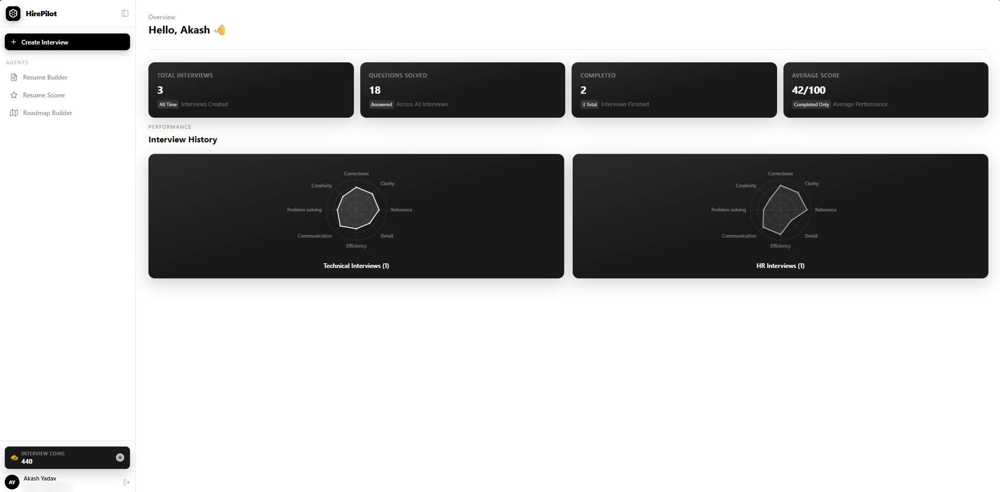
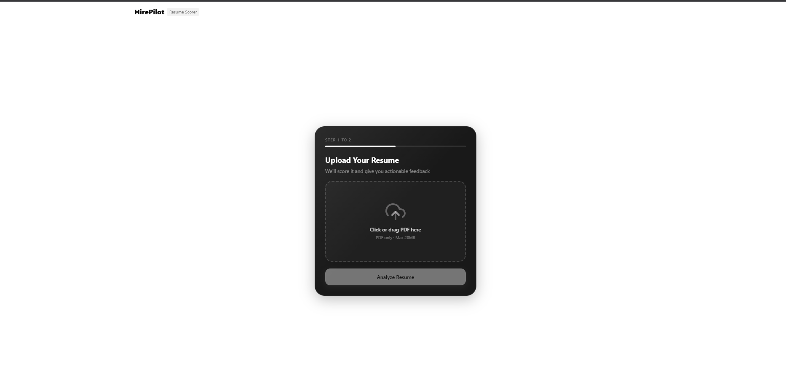
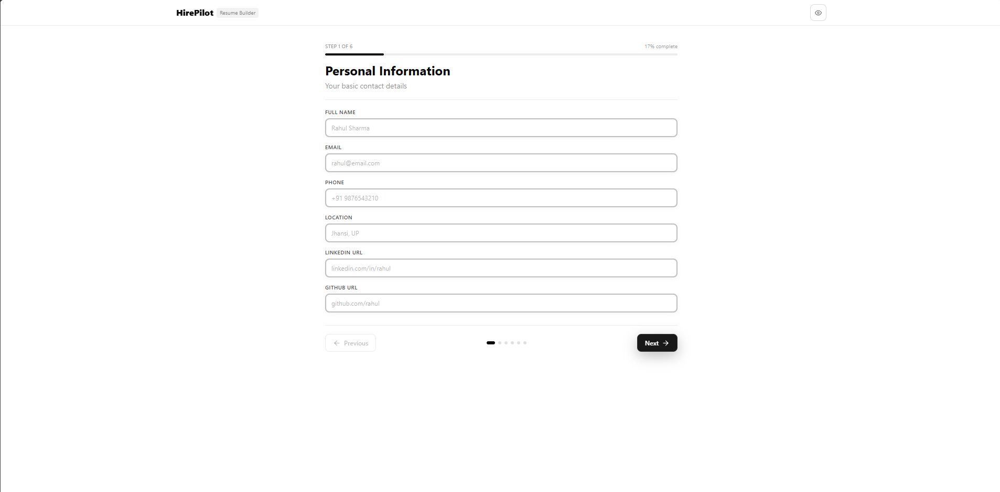
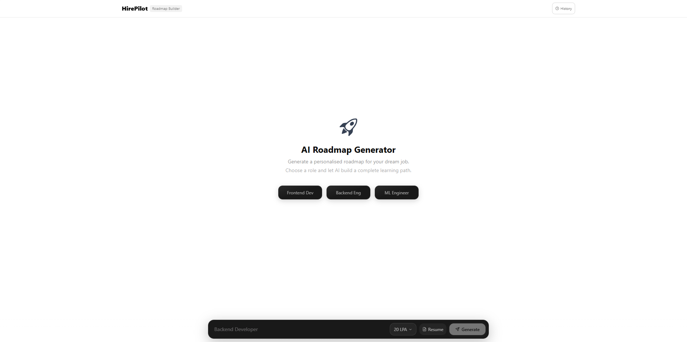
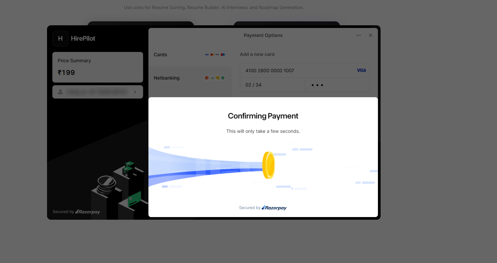
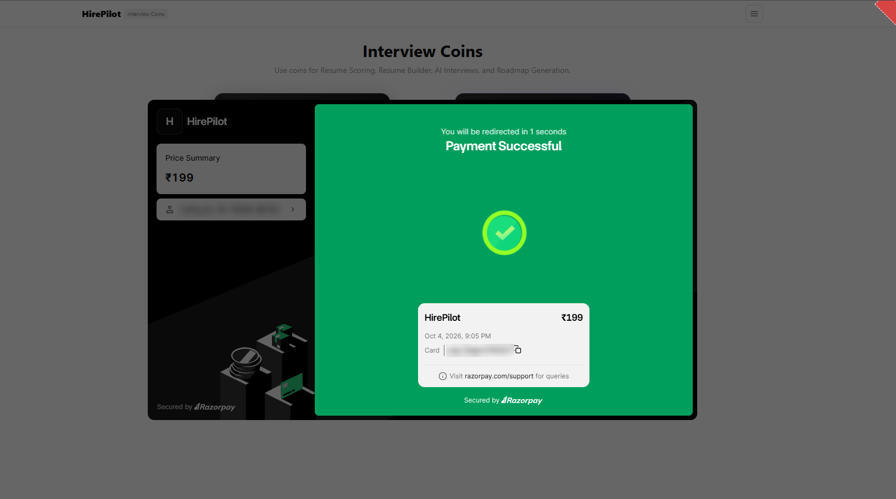

# HirePilot

An AI interview preparation platform for job seekers. Upload a resume to get an
ATS score and gap analysis, run mock interviews against an AI panel that scores
answers across nine dimensions, and generate a study roadmap for a target role.

Built as six Node.js microservices behind an API gateway, with the AI features
orchestrated as multi-agent [LangGraph](https://langchain-ai.github.io/langgraphjs/)
state machines.

---

## Screenshots

**Dashboard**: interview history scored across nine dimensions


| Resume Scorer | Resume Builder |
|---|---|
|  |  |

| Roadmap Builder | Buying coins (Razorpay test mode) |
|---|---|
|  |  |



---

## Features

| Feature | What it does |
|---|---|
| **Resume Scorer** | Parses an uploaded PDF, returns a 0–100 ATS score plus extracted skills, education, experience, strengths, weaknesses, missing skills, a suggested role, and recommendations |
| **Mock Interview** | Generates HR or technical questions for a target role (optionally grounded in your resume), scores each answer, and produces a final report |
| **Career Roadmap** | Builds a study plan of 8–15 modules for a target role and salary package (the AI picks the level and duration), then enriches each module with a video and an article |
| **Resume Builder** | Form-driven builder that renders an ATS-friendly template and exports to PDF through the browser's print dialog (runs entirely in the browser) |
| **Billing** | Razorpay checkout to top up interview coins. Coins are charged on the server by the service that does the AI work, and refunded automatically if that work fails |

---

## Architecture

```
                        React 19 + Vite  (:5173)
                                │
                                │  cookie-based session
                                ▼
                       API Gateway  (:8000)
                   authenticates once at the edge,
                  forwards verified user context down
                                │
        ┌───────────┬───────────┼───────────┬───────────┐
        ▼           ▼           ▼           ▼           ▼
      auth       resume     interview    roadmap     billing
     (:8001)     (:8002)     (:8003)     (:8004)     (:8005)
        │           │           │           │           │
        │           └─── Groq LLM via LangChain ────┐   │
        │                       │                   │   │
        ▼                       ▼                   ▼   ▼
   ┌─────────────────────────────────────────────────────┐
   │  MongoDB Atlas — one database per service           │
   │  Redis — session store + response cache             │
   └─────────────────────────────────────────────────────┘
```

**Gateway pattern.** The gateway validates sessions for every protected route.
It looks the session up in Redis, attaches the user ID as `x-user-id` plus a
shared `x-internal-key`, and proxies onward. Services reject any request
without that key, so the user ID can't be spoofed by calling a service port
directly. `/api/auth/*` is the one public prefix (login has to work without a
session); the auth service checks the session cookie itself there, and the
gateway blocks `/api/auth/internal/*` and strips internal headers from it.

**Database per service.** Each service owns its own MongoDB database, so schema
changes stay local to the service that made them.

**Redis.** Backs both the distributed session store (7-day TTL) and a
cache-aside response cache (TTLs from 10 minutes to 24 hours) that is
invalidated by deleting keys on every write, so repeated dashboard reads don't
hit Atlas. Cache keys are scoped by user ID.

**Coins.** The auth service owns the balance and an append-only ledger
(`CoinTransaction`) with a unique reference per movement. Prices live on the
server. The resume, interview and roadmap services charge through an internal
endpoint before calling the LLM (an atomic "decrement only if balance ≥ price")
and refund if the work fails. Billing credits coins itself after verifying the
Razorpay signature, keyed on the order ID, so a retried verification can never
credit twice. The browser never sends an amount.

```
Browser ──/api/interview/start──► Gateway ──► interview ──charge "start-interview"──► auth (ledger)
                                                  │                                     ▲
                                                  ├──► Groq LLM                         │
                                                  └── on failure: refund ───────────────┘

Browser ──/api/billing/verify──► Gateway ──► billing ──HMAC ok──► credit 300 (ref: order id) ──► auth
```

### Agent orchestration

The interview and roadmap features are LangGraph state machines, not single
prompts:

```
Interview graph                      Roadmap graph

   START                                START
     │ (conditional)                      │
     ├── interviewAgent ──► END           ▼
     │   generates questions          roadmapAgent
     │                                generates modules
     └── feedbackAgent                    │
         scores the answer                ▼
             │ (conditional)          resourceAgent
             ├── summaryAgent ──► END  adds video + article
             │   final report              │
             └── END                       ▼
                                          END
```

Each answer is scored on eight dimensions — correctness, clarity, relevance,
detail, efficiency, communication, problem solving, creativity — plus an overall
score. Interview progress lives in MongoDB, not in the graph, so each request
runs the graph once and an interview can be resumed after a reload.

---

## Tech stack

**Frontend** — React 19, Vite, Tailwind CSS 4, Redux Toolkit, React Router 7,
Recharts, Framer Motion, Firebase Auth

**Backend** — Node.js, Express 5, Mongoose, ioredis, LangChain + LangGraph,
Groq (`openai/gpt-oss-120b`), Firebase Admin, Multer, pdf-parse, Razorpay

**Infrastructure** — MongoDB Atlas, Redis (Docker), Firebase Authentication

---

## Getting started

### Prerequisites

- Node.js 20.12+ (developed on 24; the shared Redis client uses `process.loadEnvFile`)
- Docker Desktop (for Redis)
- A [MongoDB Atlas](https://cloud.mongodb.com) cluster
- A [Firebase](https://console.firebase.google.com) project with Google sign-in enabled
- A [Groq API key](https://console.groq.com/keys)
- A [Razorpay](https://razorpay.com) account (only for billing)

### 1. Install dependencies

```bash
# Backend — each service is independent
cd backend/gateway            && npm install
cd ../services/auth           && npm install
cd ../resume                  && npm install
cd ../interview               && npm install
cd ../roadmap                 && npm install
cd ../billing                 && npm install

# Frontend
cd ../../../frontend && npm install
```

### 2. Configure environment

Every service ships an `.env.example`. Copy each to `.env` and fill it in:

```bash
cp .env.example .env
```

| Variable | Used by | Notes |
|---|---|---|
| `MONGODB_URL` | all but gateway | Atlas connection string; give each service its own database name |
| `REDIS_URL` | gateway, auth, resume, interview, roadmap | e.g. `redis://localhost:6380` |
| `INTERNAL_API_KEY` | gateway and all five services | the same long random string everywhere |
| `AUTH_SERVICE_URL` | gateway, resume, interview, roadmap, billing | `http://localhost:8001` — the coin ledger |
| `GROQ_API_KEY` | resume, interview, roadmap | from console.groq.com |
| `YOUTUBE_API_KEY` | roadmap | YouTube Data API v3 key |
| `RAZORPAY_KEY_ID` / `RAZORPAY_KEY_SECRET` | billing | |
| `VITE_FIREBASE_APIKEY` | frontend | Firebase web API key |
| `VITE_RAZORPAY_KEY_ID` | frontend | same key ID as billing |
| `VITE_BACKEND_URL` | frontend | `http://localhost:8000` |
| `*_SERVICE_URL` | gateway | where each service listens |

Add your Firebase service account key at
`backend/services/auth/serviceAccountKey.json`, or set
`FIREBASE_SERVICE_ACCOUNT_KEY` to the JSON as a string (preferred outside
development).

> **Atlas note:** add your IP under **Network Access**, or connections will hang
> and fail with a server-selection timeout.

### 3. Start Redis

```bash
cd backend && docker compose up -d
```

Runs on host port **6380** to avoid clashing with a local Redis on 6379.

### 4. Run

On Windows, one script starts everything:

```powershell
.\start-dev.ps1      # .\stop-dev.ps1 to stop
```

Otherwise run each in its own terminal:

```bash
cd backend/gateway            && npm run dev   # 8000
cd backend/services/auth      && npm run dev   # 8001
cd backend/services/resume    && npm run dev   # 8002
cd backend/services/interview && npm run dev   # 8003
cd backend/services/roadmap   && npm run dev   # 8004
cd backend/services/billing   && npm run dev   # 8005
cd frontend                   && npm run dev   # 5173
```

The gateway must be running — the frontend only ever talks to `:8000`.

Open **http://localhost:5173**.

---

## API

All requests go through the gateway. Everything except `/api/auth/*` requires a
valid session cookie.

| Method | Endpoint | Purpose |
|---|---|---|
| `POST` | `/api/auth/login` | Exchange a Firebase ID token for a session |
| `GET` | `/api/auth/logout` | Destroy the session |
| `POST` | `/api/auth/use-coins` | Pay for a browser-only action (`{ action: "download-pdf" }`); the price is set server-side |
| `GET` | `/api/me` | Current user with a fresh coin balance |
| `POST` | `/api/resume/upload` | Upload and analyse a PDF resume |
| `GET` | `/api/resume/get-resume` | Latest analysis for the user |
| `POST` | `/api/interview/start` | Start an interview, generate questions |
| `POST` | `/api/interview/answer` | Submit an answer, get scored feedback |
| `GET` | `/api/interview/all` | Interview history and aggregate stats |
| `GET` | `/api/interview/:id` | A single interview |
| `POST` | `/api/roadmap/generate` | Generate a roadmap |
| `GET` | `/api/roadmap/all` | All roadmaps for the user |
| `GET` | `/api/roadmap/:id` | A single roadmap |
| `POST` | `/api/billing/create` | Create a Razorpay order |
| `POST` | `/api/billing/verify` | Verify the payment signature, then credit the plan's coins (idempotent) |

AI endpoints charge coins themselves and return the new balance as
`interviewCoin`; they answer `402` when the balance is too low. The auth
service's `/internal/charge`, `/internal/refund` and `/internal/credit` routes
are service-to-service only and require `INTERNAL_API_KEY`.

---

## Project layout

```
backend/
  gateway/              API gateway — auth at the edge, proxying
  services/
    auth/               Firebase sign-in, sessions, coin balance
    resume/             PDF parsing, ATS scoring
      agents/           resume analysis agent
    interview/          mock interviews
      graph/            LangGraph state machine, state, nodes
      agents/           interview, feedback, summary agents
    roadmap/            roadmap generation
      graph/            LangGraph state machine
      agents/           roadmap, resource agents
    billing/            Razorpay orders and verification
  shared/redis/         Redis client shared across services
  shared/coins/         client for the auth service's coin ledger
  shared/middleware/    requireGateway — rejects requests that bypass the gateway
frontend/
  src/
    pages/              route-level screens
    components/         UI, including the resume builder template
    apis/               typed API wrappers
    redux/              store and slices
```

---

## Security

- `.env` files, `serviceAccountKey.json`, and user uploads are gitignored
- Sessions are `httpOnly` cookies; the session ID is opaque and Redis-backed
- Razorpay payments are verified by HMAC signature server-side, and only then
  are coins credited — by the billing service, never by the browser
- Coin prices and balances are enforced server-side with atomic updates and an
  idempotent ledger
- Services accept requests only from the gateway (shared internal key), so
  `x-user-id` cannot be spoofed
- Firebase ID tokens are verified with the Admin SDK before a session is issued

Never commit `serviceAccountKey.json`. If it is ever exposed, revoke the key in
the Firebase console and issue a new one.

---

## License

ISC
